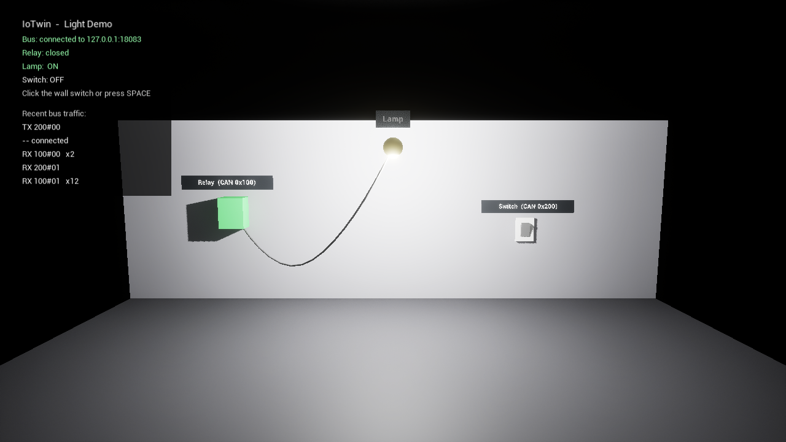

# IoTwin

A modular simulation platform combining Unreal Engine visualization with C-based IoT and CAN bus simulation.



```
 can_sim (simulated ECU) ──┐                ┌── IoTwin Visualizer (Unreal Engine 5.6)
                           ├── iotwin-bus ──┤
 more simulators, tools  ──┘  virtual CAN   └── netcat, tests, ...
```

- **iotwin-bus** – virtual CAN bus over TCP, frames as `candump`-style text lines (`123#DEADBEEF`)
- **can_sim** – simulated light control unit with a cyclic control loop (real-time capable on PREEMPT_RT Linux)
- **Visualizer** – digital twin in Unreal Engine: relay, cable, lamp and a clickable wall switch, driven by the bus
- **CAN tools** – DBC decoding (`can_monitor`), ISO-TP library, SocketCAN bridge for Linux (`candump`/`cansend` on the virtual bus)
- **Firmware + serial_bridge** – a NUCLEO-G0B1RE joins the bus as real CAN node (FDCAN, SLCAN over USB); its button is a wall switch, its LED the lamp

---

## 🚀 Quickstart

**Windows release:** unzip `IoTwin-<version>-win64.zip`, run `start-demo.bat`, click the wall switch.

**From source:**

```bash
cmake --preset gcc-debug
cmake --build --preset gcc-debug
ctest --preset gcc-debug
```

```bash
build/gcc-debug/bin/iotwin-bus     # terminal 1
build/gcc-debug/bin/can_sim        # terminal 2 (type 'help')
```

Then open `src/ue/IoTwin/IoTwin.uproject` in Unreal Engine 5.6 and press **Play**.

---

## 📦 Project Overview

- **Languages:** C11 (core), C++20 (tests, Unreal)
- **Platforms:** Linux (reference, PREEMPT_RT for real-time), Windows (MSYS2 GCC, best effort)
- **Communication:** TCP, text line protocol ([protocol](docs/dev/protocol.md))
- **Tests:** Catch2 (unit + socket integration), Unreal automation tests
- **Documentation:** MkDocs + Doxygen + ADRs (`docs/`)

| Topic | Document |
|-------|----------|
| Run the demo | [Quickstart](docs/user/quickstart.md) |
| Build | [Build Instructions](docs/dev/build_instructions.md) |
| Design | [Architecture](docs/dev/architecture_overview.md), [ADRs](docs/adr/) |
| Real-time | [Real-Time Operation](docs/dev/realtime.md) |
| Unreal side | [Visualizer](docs/dev/visualizer.md) |
| Microcontroller | [Firmware](docs/dev/firmware.md) |
| DBC, ISO-TP, SocketCAN | [CAN Tools](docs/dev/can_tools.md) |
| Release | [Packaging](docs/dev/packaging.md) |
| Next steps | [Roadmap](docs/roadmap.md) |

## License

MIT, see [LICENSE](LICENSE).
