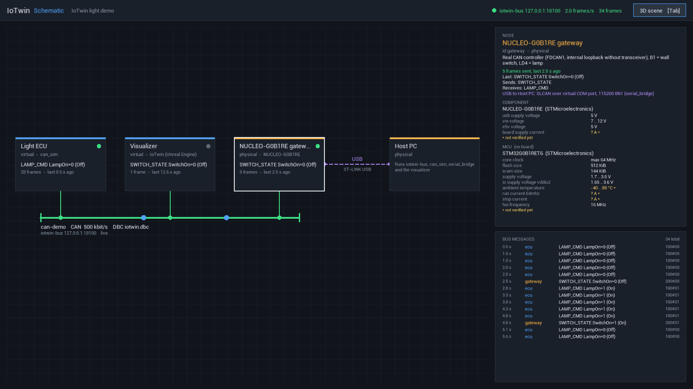

# Visualizer (Unreal Engine)

The Unreal project lives in `visualizer` (UE 5.6, C++ module `IoTwin`).

## Bus integration (`Source/IoTwin/Bus`)

| Class                   | Role                                                                 |
|-------------------------|----------------------------------------------------------------------|
| `FCanFrame`             | CAN frame struct + text codec (same format as the C core)            |
| `FIoTwinBusConnection`  | worker thread: TCP connection, auto-reconnect, line framing          |
| `UIoTwinBusSubsystem`   | game-instance subsystem: `SendFrame`, `OnFrameReceived`, `OnConnectionChanged`, last value per id |
| `UCanSignalComponent`   | maps one bit of a frame to a `bool` (Receive or Transmit)            |

Connection settings (`Config/DefaultGame.ini`):

```ini
[/Script/IoTwin.IoTwinBusSubsystem]
Host=127.0.0.1
Port=8080
bEnabled=True
```

Command line overrides: `-IoTwinBusHost=<host>`, `-IoTwinBusPort=<port>`,
`-IoTwinBusDisabled`.

### Binding a signal in Blueprint

Add a **Can Signal** component to any actor, set *Direction*, *Can Id* (hex,
e.g. `100`), *Byte Index* and *Bit Index*.

- *Receive*: bind to **On Value Changed** or read **Get Value**.
- *Transmit*: call **Set Value**; the frame is sent on change, after a
  reconnect, and optionally every *Transmit Cycle Seconds*.

For full frames use the subsystem directly (**Get IoTwin Bus Subsystem** →
**Send Frame** / **On Frame Received**).

## Schematic view (`Source/IoTwin/Schematic`)

**TAB** (or the button in the HUD) switches between the 3D scene and a 2D
schematic of the system:

- nodes from the system description (`data/systems/*.json`), the CAN bus with
  its members, other links (USB) as dashed lines;
- every frame is decoded with the DBC of the bus and shown at the node that
  sent it, with a dot travelling over the bus to the consumers;
- status per node (green < 3 s, yellow < 10 s since its last frame), frame
  rate, message log;
- click a node for details: description, messages it sends/receives, links
  and the characteristics from the component database (unverified values
  are marked);
- diagnostic frames (`"protocol": "uds"` in the system description) are
  decoded as ISO-TP/UDS, e.g. `DIAG_ECU_REQ SF ReadDataByIdentifier F190`;
- faults injected into the bus (see [Scenarios](scenarios.md)) turn the bus
  red with the active faults and the number of lost and delayed frames. The
  visualizer asks iotwin-bus with `!status` once per second and registers as
  `visualizer` (`NodeName` in `[/Script/IoTwin.IoTwinBusSubsystem]`).

| Class                        | Role                                                                 |
|------------------------------|----------------------------------------------------------------------|
| `FSystemDescription`         | loads a system JSON (nodes, buses, links, messages)                  |
| `FCanDatabase`               | DBC reader for the visualizer (messages, signals, value tables, Intel/Motorola) |
| `FComponentCatalog`          | reads `data/components/**/*.json`, formats values (`1.7 .. 3.6 V`, `64 MHz`) |
| `UIoTwinSchematicSubsystem`  | model: loads the data, follows `OnFrameReceived` / `OnFrameSent`, attributes frames to nodes, view switch |
| `FSchematicRenderer`         | draws the view on the HUD canvas (layout designed for 900 px, scaled) |

Which node sent a frame: frames sent by this game belong to `SelfNode`
(`visualizer`); for received frames the first producer of the message in the
system description other than `SelfNode` is used (iotwin-bus does not echo
frames back to their sender).

```ini
[/Script/IoTwin.IoTwinSchematicSubsystem]
SystemFile=data/systems/light-demo.json
SelfNode=visualizer
```

`SystemFile` is searched relative to the launch directory, the repository
root (`visualizer/..`) and the package root. Command line:
`-IoTwinSystem=<file>`, `-IoTwinView=Schematic` (start in the schematic),
`-IoTwinSelectNode=<node id>` (preselect a node, e.g. for screenshots).



## Dimming and power

The **mouse wheel** dims the lamp: the visualizer sends `DIMMER_CMD` (0x201)
in 10 % steps, starting from the brightness in the last `LAMP_CMD`. The power
source reads that brightness from `LAMP_CMD` byte 1 (`LevelByteIndex`), its
port carries it as `SupplyLevel`, and the lamp's light intensity and bulb
colour follow `UElectricalDeviceComponent::PowerLevel`. The HUD shows the
brightness and the ECU's measured current and supply voltage from
`LAMP_STATUS` (0x101), plus fuse, overcurrent or short circuit.

## Electrical model (`Source/IoTwin/Systems`)

- `UElectricalPortComponent`: wiring is a symmetric list of ports stored on
  both ends (saved with the level). `HasPower()` searches the wiring graph for
  a supplying port; cycles are handled.
- `APowerSourceActor`: supply with an output relay. With *Controlled By Can*
  the relay follows its `RelayControl` signal (default `0x100` byte 0 bit 0).
- `AElectricalCableActor`: two conducting ends, drawn with `CableComponent`;
  `ConnectBetween(A, B)` positions and wires it.
- `ALampActor`: port → `UElectricalDeviceComponent` → `ULightEmitterComponent`
  and a bulb that changes colour.
- `AWallSwitchActor`: clickable switch that transmits its position (`0x200`).

Older assets that only stored `ConnectedPort` are migrated automatically when
the component is registered.

## Demo scene

`AGM_Simulation` (the default game mode) builds the light demo at runtime from
engine basic shapes, so it works in any map and needs no extra assets. To build
your own scene, create a Blueprint subclass of `GM_Simulation`, untick
*Spawn Demo Scene* (the relay and switch ids are configurable there as well)
and select it as *GameMode Override* in the map's World Settings.

## Tests and smoke runs

```powershell
# Automation tests (CAN codec, DBC, system description, component database)
UnrealEditor-Cmd.exe visualizer/IoTwin.uproject -ExecCmds="Automation RunTests IoTwin;Quit" -unattended -nullrhi

# Unattended game run: screenshot after 10 s, quit after 15 s
UnrealEditor.exe visualizer/IoTwin.uproject -game -IoTwinScreenshot=10 -IoTwinQuitAfter=15

# Same in the schematic view with the gateway selected
UnrealEditor.exe visualizer/IoTwin.uproject -game -IoTwinView=Schematic -IoTwinSelectNode=gateway -IoTwinScreenshot=10 -IoTwinQuitAfter=15
```

The screenshot is written to `Saved/Screenshots/IoTwinDemo.png`.
