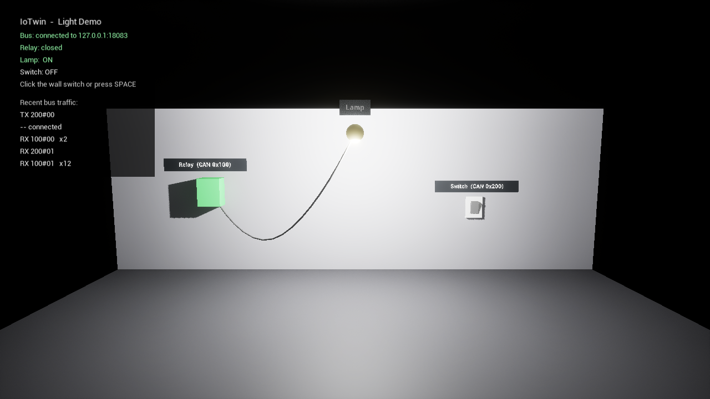

# Quickstart



The light demo shows the whole chain: a simulated control unit (ECU) switches
a lamp via a CAN bus, and an Unreal Engine visualizer mirrors the installation
as a digital twin.

```
wall switch (Visualizer) --200#01--> iotwin-bus --> can_sim (light ECU)
lamp relay  (Visualizer) <--100#01-- iotwin-bus <-- can_sim (light ECU)
```

## Windows release package

1. Download and unzip `IoTwin-<version>-win64.zip`.
2. Double-click `start-demo.bat`.
3. In the visualizer click the wall switch (or press **SPACE**).

Three windows open:

| Window            | Content                                                |
|-------------------|--------------------------------------------------------|
| IoTwin Bus        | every frame on the bus                                 |
| IoTwin CAN-Sim    | the light ECU - type commands here                     |
| IoTwin            | 3D view with status panel and recent bus traffic       |

Commands in the CAN-Sim window:

| Command                   | Effect                                         |
|---------------------------|------------------------------------------------|
| `lamp on` / `lamp off`    | ECU switches the relay                         |
| `blink 500`               | ECU toggles the lamp every 500 ms (`blink off`)|
| `send 123#DEADBEEF`       | put any frame on the bus                       |
| `status`, `help`, `quit`  |                                                |

## With a NUCLEO-G0B1RE

The board becomes a real CAN node of the demo: its blue button B1 is a second
wall switch, its green LED LD4 shows the lamp.

1. Copy `firmware\iotwin_gateway.bin` to the `NOD_G0B1RE` USB drive of the
   board (LD4 starts blinking: firmware runs, waiting for the PC).
2. Look up the COM port ("STMicroelectronics STLink Virtual COM Port" in the
   Device Manager).
3. Run `start-demo-hardware.bat COM5` (your port).

Press B1: the lamp in the visualizer and LD4 turn on. Details and wiring for a
real CAN bus: [Firmware](../dev/firmware.md).

## From source

```bash
cmake --preset gcc-debug
cmake --build --preset gcc-debug
```

Then on Windows:

```powershell
./tools/run-dev.ps1          # starts iotwin-bus and can_sim
```

and open `src/ue/IoTwin/IoTwin.uproject` in Unreal Engine 5.6 and press
**Play**. See the [Build Instructions](../dev/build_instructions.md) for details.

## Core on Linux, visualizer on Windows

For real-time experiments the core runs on a (PREEMPT_RT) Linux machine and the
visualizer connects over the network:

```bash
BIND=0.0.0.0 tools/run-core.sh          # on Linux
```

```
Visualizer\IoTwin.exe -IoTwinBusHost=<linux-ip>
```

See [Real-Time Operation](../dev/realtime.md).
